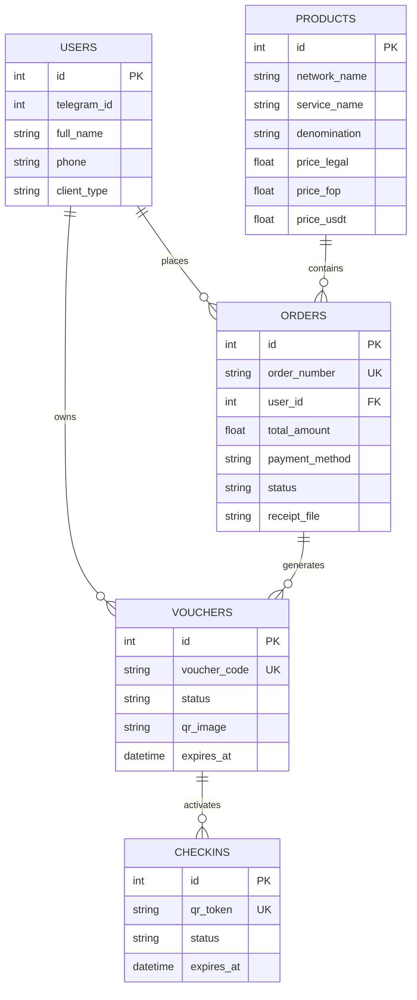

# 🎫 SmartPass — Digital Voucher, Pass & Club Membership ERP

[](https://python.org)
[](https://fastapi.tiangolo.com)
[](https://docker.com)
[](LICENSE)

> **Комерційна система електронних талонів, абонементів та сертифікатів із веб-панеллю оператора, трирівневим прайсом та захистом від повторного використання.**  
> Розроблено як еталонне MVP-рішення для автоматизації продажу та обліку паливних талонів (WOG, OKKO, Ukrnafta), клубних абонементів (фітнес, СПА, коворкінги) та подарункових сертифікатів.

---

## 🌟 Ключові можливості системи

### 1. 📊 Панель керування оператора (FastAPI + Bootstrap 5)
* **Головний дашборд:** KPI-метрики в реальному часі (замовлення до перевірки, активні талони, черга чек-іну, оборот у ₴ та USDT).
* **Модальний перегляд квитанцій:** оператор бачить завантажений чек/скріншот платежу та в один клік схвалює або відхиляє замовлення.
* **Автоматична емісія талонів:** при підтвердженні оплати система атомарно генерує унікальні талони з персональними QR-кодами.

### 2. ⚡ Термінал чек-іну та захист від подвійного використання (Race Condition)
* **Атомарні транзакції:** блокування рядків у базі даних (`SELECT ... FOR UPDATE`), що виключає подвійне списання одного й того ж талона при одночасних кліках.
* **Статусний життєвий цикл:** `AVAILABLE` (доступний) ➔ `RESERVED` (зарезервовано під візит) ➔ `USED` (погашено) або `CANCELLED` (повернено на баланс).
* **Симуляція сканера:** ручне погашення талона за кодом або токеном.

### 3. 🏷️ Трирівневий прайс-лист (ТОВ / ФОП / USDT)
* Фіксація окремих цін за номінал для:
  1. Безготівкового розрахунку юросіб ТОВ (з ПДВ).
  2. Підприємницького рахунку ФОП.
  3. Криптовалюти USDT (TRC-20) з підтримкою перерахунку курсу.

### 4. 📜 Незмінний журнал аудиту (Security Trail)
* Кожна дія адміністратора (схвалення платежу, погашення талона, зміна статусу) фіксується із зазначенням імені, часу події та IP-адреси.

### 5. 📥 Експорт звітів у Excel (XLSX) на лету
* Генерація стилізованих звітів з трьома вкладками (*Замовлення*, *Талони*, *Журнал дій*) за допомогою бібліотеки `openpyxl`.

---

## 🏗️ Архітектура бази даних



---

## 🚀 Швидкий запуск

### Варіант 1: Локально через Python

1. **Клонувати репозиторій:**
   ```bash
   git clone https://github.com/zymaneta-eng/smartpass-voucher-system.git
   cd smartpass-voucher-system
   ```

2. **Встановити залежності:**
   ```bash
   pip install -r requirements.txt
   ```

3. **Запустити веб-сервер:**
   ```bash
   python web_app.py
   ```
   *Відкрийте браузер за адресою:* `http://127.0.0.1:8000`

---

### Варіант 2: Запуск у Docker (1 команда)

```bash
docker compose up -d --build
```

---

## 🛠️ Стек технологій
* **Backend:** Python 3.12, FastAPI, Starlette, Uvicorn
* **Frontend:** Jinja2 Templates, Bootstrap 5.3, FontAwesome 6
* **Database:** SQLite / PostgreSQL (ACID-compliant)
* **Utilities:** QRCode (Pillow), OpenPyXL, AioFiles
* **DevOps:** Docker, Docker Compose, Git

---

## 👩‍💻 Автор та контакти для замовлення
**Nataliia Zyma** (ФОП Зима Н. М.)  
Python / Automation & Bot Developer  

* 💬 **Прямий зв'язок у Telegram:** [@Nataly_Zyma](https://t.me/Nataly_Zyma)
* 📧 **Офіційний Email:** `areonixwinter@gmail.com`
* 🤖 **Бот технічної підтримки:** [@AreonixSupport_bot](https://t.me/AreonixSupport_bot)
* 💼 **Профіль на Freelancehunt:** [Nataliia_Z2](https://freelancehunt.com/freelancer/Nataliia_Z2.html)
* 🏢 Офіційна розробка систем обліку, Telegram-ботів та ERP для бізнесу за договором.
